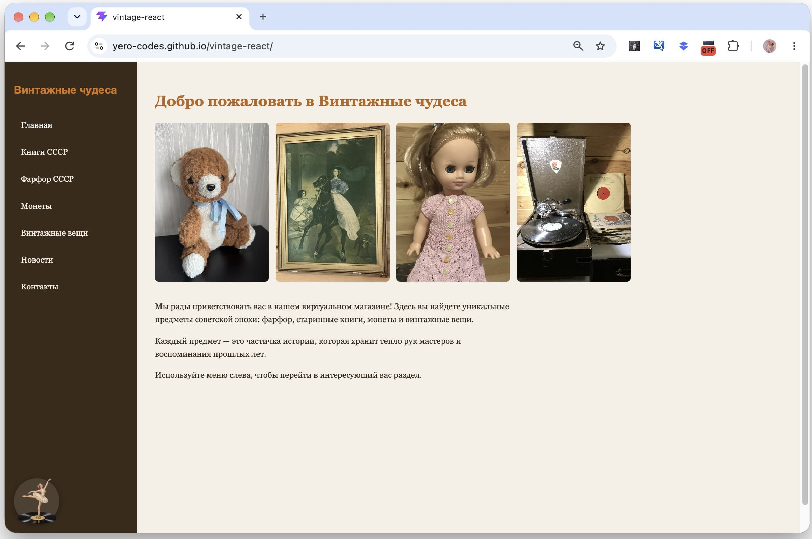
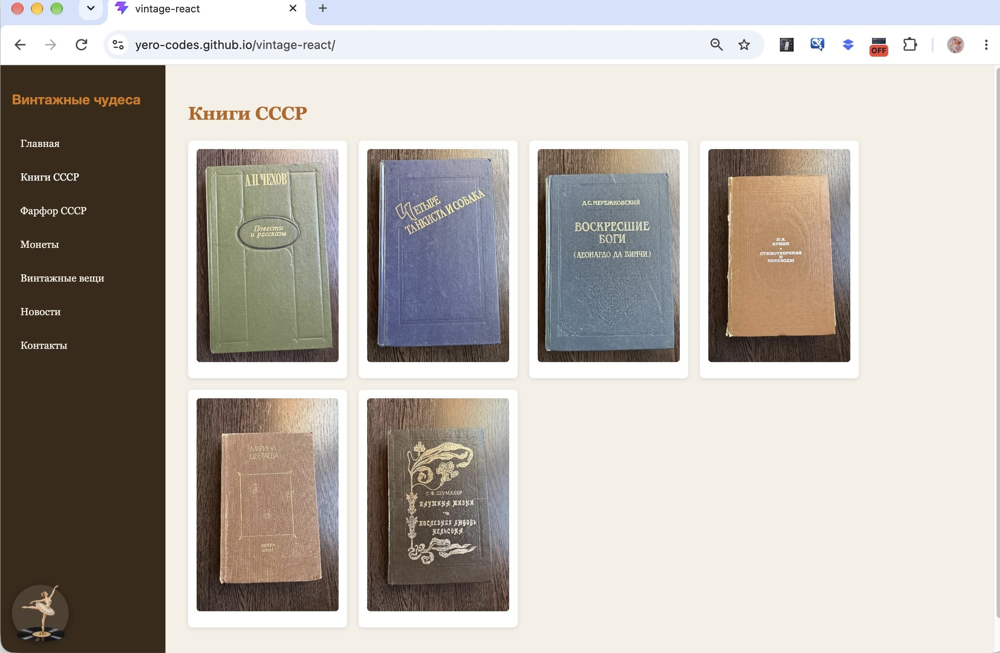
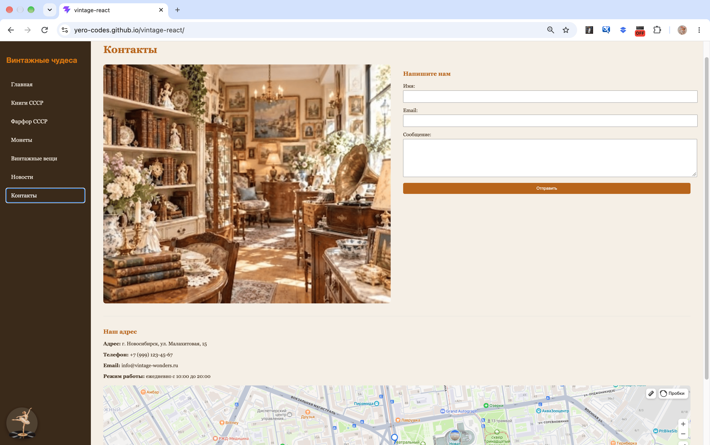

# Vintage Wonders (React Edition)

A modern reimagining of my first web project, built with React and Vite. This project demonstrates the same vintage shop concept as the original, but implemented using a component-based architecture, React state management, and modern deployment workflows.

*(Современная версия моего первого проекта, созданная на React и Vite. Проект демонстрирует тот же концепт магазина, но реализован с использованием компонентного подхода, управления состоянием и современных методов деплоя).*

## Live Demo

- React Version (Current): https://yero-codes.github.io/vintage-react/
- Original Vanilla JS Version: https://yero-codes.github.io/vintage-wonders/

## Screenshots

### Home Page


### Gallery (Books)


### Contacts & Map


## Technologies Used

- React (functional components, hooks: useState, useEffect, useRef)
- Vite (build tool)
- Conditional Rendering (for page navigation)
- CSS (Flexbox, Grid, media queries for responsiveness)
- GitHub Actions (CI/CD for automatic deployment)
- GitHub Pages (hosting)

## Features

- Component-based architecture: Modular pages (Books, Porcelain, Coins, Vintage Things) and reusable UI components (GalleryCard, NewsCard, AudioPlayer).
- State Management: Dynamic search, filtering, and modal windows using React hooks.
- Interactive Music Box: A custom audio player with a spinning ballerina animation and background music (using React useRef and useState).
- Data Fetching: Loading news from a local JSON file.
- Responsive Design: Fully adapted for mobile and desktop devices.
- Automatic Deployment: Every push to main triggers a GitHub Actions workflow to build and deploy the site.

## How to Run Locally

1. Clone the repository:
   ```bash
   git clone https://github.com/yero-codes/vintage-react.git
   ```

2. Navigate to the project directory:
```bash
cd vintage-react
```

3. Install dependencies:
```bash
npm install
```

4. Start the development server:
```bash
npm run dev
```

5. Open http://localhost:5173 in your browser.

## Author

**Elena**

GitHub: https://github.com/yero-codes